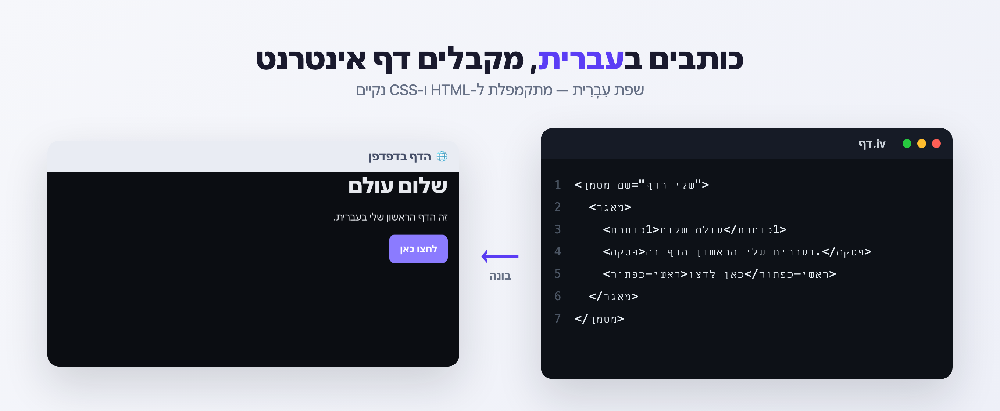
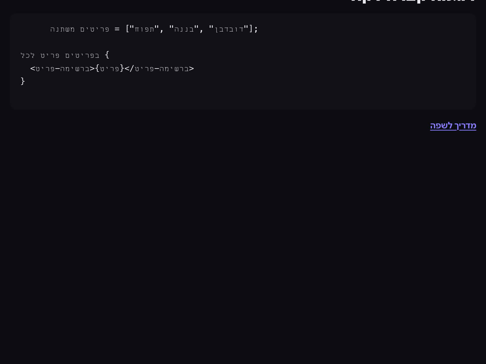

# עִבְרִית (Ivrit)

> שפת תכנות/סימון **בעברית** שמתקמפלת ל-HTML ו-CSS נקיים, ממוקדת RTL מראש.

כותבים בעברית — תגים, מאפיינים, משתנים, לולאות ו-CSS — ומקבלים קובץ HTML יחיד,
נקי, רספונסיבי ונגיש, עם ערכת עיצוב מוכנה ותמיכה במצב לילה. **אין תלויות בזמן ריצה — רק Node.js.**
עובד על **Windows, macOS ו-Linux**.



---

## ✨ דוגמה מהירה

כותבים קובץ בשם `דף.iv`:

```ivrit
<מסמך שם="הדף שלי">
  <מאגר>
    <כותרת1>שלום עולם</כותרת1>
    <פסקה>זה הדף הראשון שלי בעברית.</פסקה>
    <כפתור-ראשי>לחצו כאן</כפתור-ראשי>
  </מאגר>
</מסמך>
```

ומקבלים את הדף הזה בדפדפן:


---

## 🚀 איך מריצים קובץ `.iv`

יש שלוש דרכים — בחרו את הנוחה לכם.

### 1. דרך העורך (VS Code / Cursor) — הכי נוח, בכל מערכת
לאחר [התקנת ההרחבה](#-התקנה-על-vs-code--cursor):

1. פותחים את הקובץ `.iv` בעורך.
2. שמירה — נבנה אוטומטית קובץ HTML בתיקיית `dist/`.
3. תצוגה מקדימה בעורך / פתיחה בדפדפן דרך הקיצורים:

| פעולה | macOS | Windows / Linux |
| --- | --- | --- |
| תצוגה מקדימה | `⌘⌥V` | `Ctrl+Alt+V` |
| בנייה | `⌘⌥B` | `Ctrl+Alt+B` |
| פתיחה בדפדפן | `⌘⌥R` | `Ctrl+Alt+R` |
| החלפת כיוון (LTR) | `⌘⌥L` | `Ctrl+Alt+L` |

### 2. דרך הטרמינל (בכל מערכת)
```bash
node bin/ivrit.js build דף.iv -o דף.html   # בונה
node bin/ivrit.js serve דף.iv               # שרת חי עם רענון אוטומטי
```

### 3. בלי שום עורך — לחיצה כפולה
דורש ש-Node.js יהיה מותקן. הדף נבנה ליד קובץ ה-`.iv` ונפתח בדפדפן:

- **Windows:** גוררים קובץ `.iv` על **`run-windows.cmd`** (או מריצים `run-windows.cmd myfile.iv`).
- **macOS / Linux:** לחיצה כפולה על **`run-mac.command`** ← בוחרים קובץ `.iv` (או גוררים קובץ עליו).

---

## 🖥️ מבט על היכולות

זה `examples/home.iv` — כל מה שהשפה יודעת לעשות, בקובץ אחד, וכך זה נראה בפלט:



שימו לב: תגים, משתנים, פונקציות, רכיבים ובלוקי קוד — הכול בעברית, וה-RTL תקין (גם בתוך הקוד).

---

## 📦 התקנה

```bash
npm install -g ivrit      # התקנה גלובלית (מוסיף פקודת ivrit)
# או, לפיתוח מקומי:
npm link
```

לאחר מכן אפשר להשתמש ב-`ivrit` במקום `node bin/ivrit.js`:

```bash
ivrit build index.iv -o dist/index.html   # קומפילציה
ivrit check index.iv                      # בדיקת שגיאות ואזהרות
ivrit serve index.iv                      # שרת פיתוח עם טעינה מחדש
ivrit new my-site                         # פרויקט חדש מוכן
```

## 🧩 התקנה על VS Code / Cursor

ההרחבה נותנת תחביר צבעוני, השלמות, בנייה אוטומטית בכל שמירה, תצוגה מקדימה ושגיאות בלוח הבעיות.

```bash
cd editors/vscode
node scripts/vendor.js && node scripts/make-vsix.js
code   --install-extension ivrit-1.0.1.vsix   # ל-VS Code
cursor --install-extension ivrit-1.0.1.vsix   # ל-Cursor
```

או דרך הממשק (בכל מערכת): פאנל התוספים (**⌘⇧X** / **Ctrl+Shift+X**) → תפריט **"..."** → **Install from VSIX**.
פשוט צרו קובץ בסיומת `.iv` והעורך יזהה אותו אוטומטית.

הקיצורים זהים בכל המערכות, רק החליפו `⌘⌥` ב-`Ctrl+Alt` על Windows/Linux (ראו הטבלה למעלה).

> **טיפ ל-RTL בעורך:** עורכי קוד מציגים שורה שמתחילה בעברית מימין-לשמאל, מה שמפזר את סימני
> הקוד. **⌘⌥L** (או `ivrit ltr קובץ.iv`) מוסיף סימני כיוון בלתי-נראים שמסדרים את התצוגה
> לשמאל-לימין — **הפלט לא מושפע כלל.**

---

## 📖 שפה במבט מהיר

### תגים
תגים נכתבים בעברית, וכל תג HTML רגיל גם עובד כמות שהוא. כל תג עברי מקבל אוטומטית מחלקה בשמו
(`<פסקה>` → `class="פסקה ivrit-p"`).

```ivrit
<כותרת2>כותרת</כותרת2>
<עמודות>
  <עמודה>שדה אחד</עמודה>
  <עמודה>שדה שני</עמודה>
</עמודות>
```

### מאפיינים
`סגנון`, `מחלקה` ו-`מזהה` הם הגרסה העברית של `style`, `class` ו-`id`:

```ivrit
<קישור מקור="https://example.com">קישור</קישור>
<פסקה מזהה="מבוא" מחלקה="פתיחה" סגנון="צבע: צבע-ראשי; גופן-גודל: 1.2rem">
```

### משתנים ופונקציות
```ivrit
משתנה שם = "עולם";
משתנה צבע-ראשי: #5b3df5;          -- משתנה גלם: נכנס ל-CSS כמשתנה

פונקציה ברוכים(שם) {
  מחזיר "שלום " + שם + "!";
}

<פסקה>{ברוכים(שם)}</פסקה>
```

### תנאים ולולאות
```ivrit
אם גיל >= 18 {
  <פסקה>בוגר</פסקה>
} אחרת {
  <פסקה>קטין</פסקה>
}

לכל שם בשמות {
  <פריט>{שם}</פריט>
}

לכל-בטווח i מ-1 עד-5 {
  <li>i</li>
}
```

### רכיבים
רכיב הוא חתיכת HTML עם פרמטרים, עם חריץ (`{ילדים}`):

```ivrit
רכיב כרטיס-תוכן(כותרת, צבע) {
  <כרטיס>
    <כותרת3 סגנון="צבע: {צבע}">{כותרת}</כותרת3>
    {ילדים}
  </כרטיס>
}

<כרטיס-תוכן כותרת="מהיר" צבע="{צבע-ראשי}">
  <פסקה>תוכן שנזרק פנימה</פסקה>
</כרטיס-תוכן>
```

### עיצוב
בלוק `סגנון` כותב CSS במילים עבריות, עם תמיכה בשילוב (`&`) ובמצבי מסך:

```ivrit
סגנון .כרטיס {
  רקע: לבן;
  פינות-עגולות: 12px;
  & כותרת3 { צבע: צבע-ראשי; }
}

סגנון מסך-לילה {
  רקע: שחור-מלא;
  צבע: לבן-מלא;
}
```

### קוד ותוכן מילולי
התוכן של `<קוד>` ו-`<קוד-בלוק>` מוצג כמות שהוא — בלי להריץ ובלי לפרש `{...}`.
כדי להדפיס `<div>` בטקסט כותבים `&lt;div&gt;`.

### הערות
```ivrit
-- הערת שורה בעברית
// הערת שורה רגילה
/* הערת בלוק */
```

---

## 📚 כללי שפה

| קונספט | כתיב | HTML |
| --- | --- | --- |
| משתנה | `משתנה x = 5;` | — |
| משתנה גלם | `משתנה צבע: #5b3df5;` | `--צבע: #5b3df5` |
| תנאי | `אם x > 1 { ... } אחרת { ... }` | — |
| מערכים | `לכל p ב[1, 2, 3] { ... }` | — |
| טווח | `לכל-בטווח i מ-1 עד-9 { ... }` | — |
| חזרה | `כל-עוד x < 10 { ... }` | — |
| פונקציה | `פונקציה שם(א) { מחזיר א; }` | — |
| רכיב | `רכיב כרטיס(כותרת) { ... }` | — |
| הדפסה למסוף | `הדפס "שלום";` | — |
| ייבוא | `ייבא "./header.iv";` | — |
| משתנה בתוך טקסט | `{שם}` | — |

### מילות CSS נפוצות
- צבעים: `אדום`, `כחול-כהה`, `אפור`, `ירוק`, `זהב`, `לבן-מלא`
- מידות: `מלא` (`100%`), `חצי`, `שליש`, `רבע`
- משקלות: `דק`, `רגיל`, `בינוני`, `מודגש`
- יישור: `למרכז`, `לימין`, `לשמאל`
- מצבי מסך: `מסך-טלפון`, `מסך-טבלט`, `מסך-לילה`, `מסך-הדפסה`

---

## 🛠️ שימוש כספרייה

```js
import { compile, compileFile } from 'ivrit';

const { html, css, errors, warnings } = compile('<פסקה>שלום</פסקה>', { file: 'דף.iv' });
```

| ייצוא | תיאור |
| --- | --- |
| `compile(source, options)` | מקמפל מחרוזת מקור |
| `compileFile(file, options)` | מקמפל קובץ מהדיסק |
| `html` | הדף המלא |
| `css` | גיליון ה-CSS שנוצר |
| `errors` / `warnings` | שגיאות ואזהרות עם מיקום שורה |

---

## 🧪 פיתוח

```bash
npm test           # בדיקות השפה
npm run test:all   # כולל בדיקות ההרחבה
npm run build      # בניית הדוגמה
npm run serve      # הצגת הדוגמה
```

לפרטים על המבנה הפנימי ראו [`CLAUDE.md`](CLAUDE.md).

## רישיון

MIT
